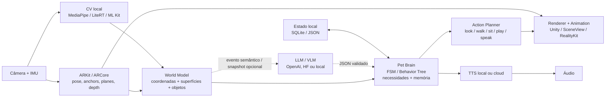

# Bichinhos virtuais com câmera, realidade aumentada e IA em dispositivos móveis

## Resumo executivo

O padrão técnico mais interessante para um novo “pet virtual que entende o mundo real” não é simplesmente colocar um modelo 3D sobre o vídeo da câmera. Os produtos mais convincentes combinam quatro camadas: **rastreamento espacial**, para saber onde estão piso, mesa e câmera; **percepção semântica**, para reconhecer objetos, pessoas ou tipos de superfície; **um modelo persistente do bichinho**, com necessidades, personalidade e memória; e **uma camada de IA opcional**, usada para diálogo, planejamento de comportamento ou compreensão visual mais sofisticada. Pokémon GO já usa câmera e detecção do ambiente para fixar criaturas no espaço; Peridot levou isso mais adiante com navegação em torno de objetos e reconhecimento do ambiente; e trabalhos acadêmicos exploram explicitamente pets cujos comportamentos são condicionados pela semântica da cena. Duas mudanças recentes são importantes para qualquer decisão técnica em 2026. **TensorFlow Lite passou a ser apresentado pelo Google como LiteRT**, e o próprio Google recomenda LiteRT-LM para novos projetos de LLMs locais, enquanto a API LLM Inference do MediaPipe está em modo de manutenção. **Lightship/ARDK 3.x também virou tecnologia legada**: o portal antigo Lightship.dev foi desativado em fevereiro de 2026 e o caminho atual da Niantic é o **Niantic Spatial SDK, ou NSDK, 4.x**, com localização VPS, depth, occlusion, meshing e semantics. Já **Meta Spark não deve ser escolhido para um novo projeto**: a Meta encerrou os efeitos AR de terceiros feitos com Spark para Instagram, Facebook e Messenger em 14 de janeiro de 2025. Para um primeiro protótipo multiplataforma, a combinação com menor risco técnico é, na minha avaliação, **Unity + AR Foundation + ARKit/ARCore + MediaPipe ou LiteRT**, mantendo toda a percepção contínua no aparelho e chamando um LLM na nuvem apenas para eventos de alto nível. O AR Foundation oferece uma API comum sobre provedores como ARKit e ARCore, embora recursos avançados permaneçam dependentes do provedor — por exemplo, meshing é muito mais completo em ARKit/LiDAR que no caminho ARCore padrão. Para um projeto que queira maximizar a quantidade de código sob licença permissiva, a alternativa que eu priorizaria é **Android-first em Kotlin + SceneView + ARCore + MediaPipe/LiteRT**, com o código da aplicação sob Apache-2.0 ou MIT. SceneView é Apache-2.0 e fornece uma camada declarativa 3D/AR, enquanto MediaPipe e OpenCV também oferecem bases permissivas. Ainda assim, é importante distinguir “meu projeto é open source” de “toda a pilha é open source”: ARCore, ARKit, Core ML, ML Kit e vários serviços espaciais são runtimes/plataformas proprietários, mesmo quando seus samples são publicados sob licenças abertas. A arquitetura que melhor equilibra latência, custo e privacidade é:

**câmera + IMU → AR tracking/depth → CV local → world model semântico → behavior engine determinístico → LLM opcional → animação/TTS**.

O LLM não deve estar no loop de renderização. O animal precisa continuar andando, piscando, desviando de obstáculos e reagindo ao toque mesmo sem rede. A IA generativa entra como uma camada lenta de decisão e personalidade; visão, posicionamento e animação continuam locais. Essa separação também permite não transmitir vídeo contínuo da casa do usuário para servidores externos.

## Produtos, experiências e pesquisa acadêmica relevantes

### O que os produtos comerciais realmente fazem com a câmera

| Produto / plataforma | Uso do feed da câmera e do ambiente | Ideia reutilizável para um pet |
|---|---|---|
| **Pokémon GO – AR+** | A câmera é movimentada pelo usuário para que o aplicativo detecte o espaço e uma superfície plana; depois do reconhecimento do ambiente aparece “grama alta”, e o Pokémon fica fixo espacialmente no mundo real. O jogo ainda considera a aproximação/movimento do jogador. A documentação oficial em português descreve explicitamente esse fluxo. | Excelente MVP: detectar piso/mesa → criar anchor → fazer o pet reagir à distância da câmera. |
| **My Tamagotchi Forever** | O modo AR transforma o ambiente real em área de esconde-esconde: Tamagotchis e recompensas são posicionados no espaço visto pela câmera. A Bandai Namco ainda descreve oficialmente “Hide & Seek” no ambiente real; a listagem da App Store indica suporte AR em dispositivos compatíveis com ARKit. | Demonstra que o componente AR pode ser um modo especial do pet, em vez de toda a aplicação depender de AR. |
| **Peridot** | A proposta da Niantic foi um pet AR que percebe o ambiente, navega pelo mundo real e pode passar visualmente atrás ou entre elementos, além de responder a características do terreno/objetos. | Referência mais próxima de “animal que entende a casa”: semantics + depth + comportamento contextual. |
| **Project Jade / Peridot + IA** | Demonstração da Niantic com pet/contexto em primeira pessoa, combinando informação visual, localização/VPS e uma camada de IA para interação conversacional e contextual. | Modelo conceitual para “pet pergunta sobre o que está vendo” sem colocar visão generativa em todos os frames. |
| **Snapchat / Camera Kit / Lens Studio** | Camera Kit permite incorporar Lenses em apps iOS, Android e web. Lens Studio dispõe de body/face tracking, world tracking, background segmentation, Location AR e integração de modelos customizados para segmentation e object detection. | Muito bom para experiências camera-first e filtros; menos apropriado que ARKit/ARCore para um simulador com mundo persistente complexo. |
| **Instagram/Facebook AR – Meta Spark** | Foi historicamente um dos grandes ecossistemas de filtros AR, porém a plataforma para efeitos de terceiros foi encerrada em 14 de janeiro de 2025. | Referência histórica de UX, não uma dependência recomendável em 2026. |
| **Niantic Spatial SDK** | O sucessor atual do Lightship reúne VPS/localização, depth, occlusion, meshing e semantic understanding, com caminhos para Unity, Swift e Kotlin. | Interessante quando o pet deve reconhecer categorias do espaço e/ou ficar persistentemente ancorado a locais reais. |

Há uma diferença de produto muito importante entre **“AR como cenário”** e **“AR como sensor”**. Em Pokémon GO e Tamagotchi, o mundo físico é essencialmente o palco no qual um personagem é colocado. Em uma experiência semelhante a Peridot, o ambiente passa a fazer parte das regras: “há uma mesa aqui”, “há algo na minha frente”, “posso me esconder atrás disto”, “isto parece chão”. É essa segunda categoria que abre espaço para IA e cria a impressão de uma criatura realmente situada no ambiente. ### Resultados acadêmicos úteis para o design

O trabalho **“Scene-Aware Behavior Synthesis for Virtual Pets in Mixed Reality”**, publicado na CHI 2021, é diretamente relevante: a questão estudada é como sintetizar comportamentos de um pet virtual considerando a semântica da cena real, em vez de fazê-lo executar animações independentes do ambiente. A implicação de engenharia é forte: vale a pena manter uma representação intermediária do mundo — objetos, superfícies e relações — e entregar isso ao behavior engine, em vez de deixar cada subsistema analisar pixels diretamente.

Outro estudo de AR móvel, **“Don’t Bother Me: How to Handle Content-Irrelevant Objects in Handheld Augmented Reality”**, comparou estratégias para lidar com objetos físicos que interferem no conteúdo AR e mediu seus efeitos sobre engajamento e percepção de um pet virtual. Isso reforça que **occlusion e colisão não são apenas detalhes gráficos**: quando o pet atravessa uma cadeira, parede ou sofá, quebra-se a ilusão de presença.

Trabalhos posteriores também exploraram pets em AR como mecanismos de interação social e afeto, incluindo experiências que usam um “petpet” digital em interações envolvendo uma pessoa e seu cão real. Em termos de produto, isso sugere que a percepção da câmera pode gerar mecânicas além de “andar pelo chão”: reconhecer uma pessoa, detectar outro animal, perceber um objeto favorito ou reagir a ações reais pode ser parte do vínculo com o personagem.

O principal insight acadêmico para o projeto, portanto, é tratar o pet como um **agente corporificado**, não como um chatbot desenhado em 3D. O estado `curioso → olha → aproxima → cheira → reage` deve ser governado pela geometria e pelos eventos percebidos; o LLM pode escolher ou explicar intenções, mas não deveria substituir a lógica espacial.

## Comparação de SDKs, APIs e frameworks

A tabela abaixo separa conscientemente **AR espacial** de **visão/ML**. OpenCV, MediaPipe, LiteRT, Core ML e ML Kit não substituem ARKit/ARCore: eles interpretam imagens, mas não fornecem por si só o mesmo sistema de coordenadas estável, anchors e tracking espacial.

| Tecnologia | iOS | Android | Plane / tracking espacial | Depth / occlusion / ambiente | Visão / IA | Licença / abertura | Custo e observações |
|---|---:|---:|---|---|---|---|---|
| **ARKit** | ✅ | — | World tracking, anchors e detecção de planos; combina dados visuais e movimento do dispositivo. | Scene Reconstruction/mesh em dispositivos LiDAR; depth e people occlusion. | Pode ser combinado com Core ML/Vision. | Framework proprietário da Apple. | Sem tarifa separada do ARKit; distribuição pelo Apple Developer Program normalmente envolve a assinatura anual de US$99, sujeita às regras/valores regionais da Apple. |
| **ARCore** | Parcial para certos serviços cloud; tracking AR principal é Android | ✅ | Motion tracking com SLAM, anchors e planos horizontais/verticais. | Depth API produz mapas de profundidade usados para occlusion, hit tests e interação com geometria. | Pode ser combinado com ML Kit/LiteRT. | Samples oficiais Apache-2.0; isso não torna todo o runtime Google Play Services open source. | Core local não tem cobrança por frame; recursos cloud têm quotas. Cloud Anchors e Geospatial possuem limites documentados. |
| **Unity AR Foundation** | ✅ | ✅ | API comum sobre ARKit/ARCore para planes, anchors, raycasts, tracking e câmera. | Depende do provider; por exemplo, suporte a meshing não é uniforme entre ARKit e ARCore. | Integra facilmente plugins ML e Unity Sentis/ONNX ou código nativo. | Samples sob Unity Companion License; engine/componente Unity têm seus próprios termos. | Unity Personal é gratuito até o limite de US$200 mil de receita/funding; acima disso entram planos pagos. A tabela de 2026 lista Pro a US$2.310/seat/ano ou US$210/mês. |
| **Vuforia Engine** | ✅ | ✅ | Device Tracking 6DoF via Vuforia Fusion; Image Targets, Ground Plane e outros targets. | Area Targets usam scan 3D de espaços; foco muito forte em reconhecimento de objetos/locais conhecidos. | Recursos especializados de reconhecimento, Model Targets etc. | Proprietário. | Basic é gratuito e permite publicação sem watermark com Image/Multi/Cylinder Targets, VuMarks e Ground Plane. Model Targets, Area Targets e recursos avançados exigem Premium/Enterprise; preço comercial é por contato. |
| **OpenCV** | ✅ | ✅ | Não fornece AR world tracking completo por padrão. | Algoritmos de câmera/geometria podem ser construídos manualmente. | CV geral: filtros, features, calibração, DNN, tracking etc. | **Apache-2.0**, permissiva e adequada a uso comercial. | Gratuito/open source; OpenCV 4.14.0 foi lançado em julho de 2026. |
| **MediaPipe** | ✅ | ✅ | — | — | Object/image/face/hand/pose/segmentation e outras Tasks; suporte oficial a Android e iOS. | Projeto open source; samples/código Google tipicamente Apache-2.0, documentação CC BY 4.0. | Gratuito; excelente escolha para percepção local. |
| **LiteRT, ex-TensorFlow Lite** | ✅ | ✅ | — | — | Runtime on-device para modelos `.tflite`, com aceleração CPU/GPU/NPU; usado em segmentação, visão, fala e LLMs locais. | Ecossistema open source; é preciso auditar separadamente licença dos pesos dos modelos. | Sem cobrança de API para inferência local. LiteRT-LM é hoje o caminho Google para LLMs locais. |
| **Core ML** | ✅ | — | — | — | Runtime ML nativo Apple, com execução e algumas formas de atualização/personalização on-device. | Framework Apple proprietário. | Sem cobrança por inferência; excelente para um app exclusivamente Apple. |
| **ML Kit** | ✅ | ✅ | — | — | Object detection/tracking, face, pose, OCR etc.; object tracking funciona sobre imagens/live camera e aceita modelos customizados LiteRT. | SDK Google proprietário; vários samples são Apache-2.0. | APIs mobile são oferecidas gratuitamente; execução on-device funciona offline para diversos recursos. Google está separando ML Kit das antigas APIs on-device do Firebase ML, que têm desligamento previsto para 15 de junho de 2027. |
| **Niantic Spatial SDK / NSDK** | ✅ | ✅ | Integra localização espacial/VPS e tracking com as plataformas mobile. | Depth, occlusion, meshing e scene semantics. | Semantic segmentation e outros serviços espaciais. | SDK/samples públicos são regidos por termos da Niantic Spatial, não por uma licença OSS permissiva geral. | A página atual da plataforma utiliza créditos e mostra tiers Free/Plus/Pro; produção comercial deve ser validada contra os termos vigentes do produto específico. |
| **Snap Camera Kit / Lens Studio** | ✅ | ✅ | World tracking e Location AR estão entre as capacidades de Lenses. | Background/custom segmentation e efeitos ligados ao mundo/câmera. | Pode incorporar custom segmentation/object-detection models. | Proprietário, sujeito aos Camera Kit/Lens Studio Terms. | Melhor avaliar comercialmente com a Snap; não há uma licença OSS comparável a OpenCV/MediaPipe. |

### Como eu escolheria entre eles

**Para um pet 3D multiplataforma:** AR Foundation é a opção pragmática. O valor está menos no tracking em si e mais no fato de que Unity já resolve animação, skeleton, blend trees, física, áudio, partículas, UI e deployment iOS/Android. O custo é aceitar Unity e as plataformas AR proprietárias como dependências. **Para Android com forte preferência por código aberto:** SceneView + ARCore + MediaPipe/LiteRT oferece uma base muito boa. SceneView fornece 3D/AR declarativo sobre Jetpack Compose e integra Filament/ARCore, sob Apache-2.0. **Para iOS de alta qualidade:** ARKit + RealityKit/SceneKit + Core ML simplifica muito a integração com hardware Apple, particularmente quando LiDAR e scene reconstruction importam. **Para reconhecimento de marcadores, produtos físicos ou CAD:** Vuforia continua mais especializado que AR Foundation puro, sobretudo com Image Targets, Model Targets e Area Targets. **Para persistência geográfica/VPS e compreensão espacial pronta:** Niantic Spatial é tecnologicamente atraente, porém aumenta dependência de serviço/termos comerciais. Em 2026, qualquer tutorial antigo que peça “Lightship ARDK 3.x” deve ser tratado como legado e migrado para NSDK 4.x. ## Projetos open source e repositórios úteis

A diferença entre **“código está no GitHub”** e **“código pode ser incorporado livremente ao meu projeto”** é crítica. Uma ausência de `LICENSE` não deve ser interpretada como MIT/Apache; para um produto novo, eu usaria esses projetos apenas como referência até obter permissão ou confirmar a licença.

| Projeto | Link | O que demonstra | Licença / avaliação |
|---|---|---|---|
| **Unity AR Foundation Samples** | [github.com/Unity-Technologies/arfoundation-samples](https://github.com/Unity-Technologies/arfoundation-samples) | Samples oficiais para planes, anchors, raycasts, image tracking, occlusion, câmera e outros recursos cross-platform de AR Foundation. | Unity Companion License: útil como sample oficial, mas **não é uma licença permissiva independente equivalente a MIT/Apache**. |
| **ARCore Android SDK** | [github.com/google-ar/arcore-android-sdk](https://github.com/google-ar/arcore-android-sdk) | Samples Android oficiais de ARCore e ponto de partida para tracking/anchors/planes. | **Apache-2.0 para o repositório/sample code**. |
| **SceneView** | [github.com/SceneView/sceneview](https://github.com/SceneView/sceneview) | Framework declarativo 3D/AR; Android/Compose, Apple/SwiftUI e web; integra mecanismos nativos como ARCore/ARKit. | **Apache-2.0.** Uma das melhores bases abertas para experimentar UI + AR sem Unity. |
| **MediaPipe Samples** | [github.com/google-ai-edge/mediapipe-samples](https://github.com/google-ai-edge/mediapipe-samples) | Exemplos Android/iOS/web/Python de object detection, segmentation, gesture/pose etc. | **Apache-2.0** nos samples. |
| **ARCore Depth API Codelab** | [github.com/google-ar/codelab-depth-api](https://github.com/google-ar/codelab-depth-api) | Demonstra Depth API, geometria e occlusion — exatamente o que é necessário para colocar um pet atrás de objetos ou fazê-lo reagir à distância física. | **Apache-2.0** no sample/codelab. |
| **ARCore Raw Depth Codelab** | [github.com/google-ar/codelab-raw-depth-api](https://github.com/google-ar/codelab-raw-depth-api) | Acesso e visualização de raw depth, útil para experimentar colisão/percepção espacial própria. | **Apache-2.0.** |
| **Lightship VPS Demos — Dilmer Valecillos** | [github.com/dilmerv/LightshipVPSDemos](https://github.com/dilmerv/LightshipVPSDemos) | Demos Unity de VPS/Lightship; bom material educacional para localização espacial. | **MIT**, mas usa a geração Lightship antiga; adapte conceitos ao NSDK atual. |
| **AR Pet** | [github.com/markzhengma/ar-pet](https://github.com/markzhengma/ar-pet) | Jogo de pet AR com foco educacional/saúde mental; demonstra como transformar interações de cuidado em experiência AR. | Não localizei uma licença permissiva clara na pesquisa; tratar como **referência**, não copiar código até confirmar. |
| **smARt_pet** | [github.com/wwkb123/smARt_pet](https://github.com/wwkb123/smARt_pet) | Experimento ARKit com plane detection e integração de serviços de IA/voz da IBM Watson para um pet voltado a interação/saúde mental. | Licença não ficou clara nos resultados consultados; usar como referência arquitetural. |
| **Niantic Spatial SDK Samples – C#** | [github.com/nianticspatial/nsdk-samples-csharp](https://github.com/nianticspatial/nsdk-samples-csharp) | Samples atuais para NSDK 4.x e substitutos dos antigos ARDK samples. | Código público, porém regido pelos **Niantic Spatial Platform Terms**, e portanto não deve ser tratado como MIT/Apache. |
| **llama.cpp** | [github.com/ggml-org/llama.cpp](https://github.com/ggml-org/llama.cpp) | LLM/VLM local em C/C++; inclui caminhos Android e exemplo SwiftUI para inferência em iPhone. | **MIT.** |
| **sherpa-onnx** | [github.com/k2-fsa/sherpa-onnx](https://github.com/k2-fsa/sherpa-onnx) | STT, TTS e outras tarefas de áudio offline em diversas plataformas; há aplicações Android/iOS relacionadas. | Framework **Apache-2.0**, mas a licença dos **pesos de cada modelo/voz precisa ser auditada separadamente**. |

Um detalhe jurídico recorrente em projetos de IA é que existem pelo menos três licenças diferentes a auditar: **código do runtime**, **pesos do modelo** e, quando aplicável, **voz/dataset/asset**. O fato de llama.cpp ser MIT ou sherpa-onnx ser Apache-2.0 não concede automaticamente direitos sobre qualquer LLM ou voz carregada neles. Discussões recentes no próprio sherpa-onnx mostram justamente problemas de modelos distribuídos sem licença explícita. ## Integração de visão, comportamento, diálogo e voz com IA

### Detecção e segmentação em tempo real

O primeiro nível de “inteligência” do pet não precisa de um modelo multimodal gigante. Para ações como “olhar para uma pessoa”, “não atravessar o sofá”, “ir até um brinquedo”, “sentar no chão” ou “ficar escondido atrás de algo”, **detecção e segmentação locais** são mais rápidas, baratas e privadas.

ML Kit consegue detectar e rastrear objetos em imagens ou feed ao vivo, mantendo identificadores de tracking; a implementação iOS documenta tracking simultâneo de até cinco objetos. Modelos LiteRT customizados também podem ser conectados ao detector. MediaPipe é mais flexível quando você quer trocar modelos ou combinar object detection, image segmentation, pose e face sem ficar preso à API de alto nível do ML Kit. Um pipeline razoável seria:

```text
Câmera 30–60 fps
   │
   ├── ARKit/ARCore: pose + planes + depth        → todos os frames relevantes
   │
   └── detector/segmentador local                  → amostragem menor
              │
              └── "person", "chair", "table", masks, confidence
                               │
                               ▼
                         World Model
```

O detector não precisa rodar na mesma taxa da renderização. Para um protótipo, eu trataria **30–60 fps como alvo de render/tracking** e começaria a percepção semântica em algo como **5–15 inferências/s**, ajustando dinamicamente conforme o dispositivo. Esses números são metas de engenharia, não garantias dos SDKs: modelos e celulares variam muito.

Para casos em que as classes não são conhecidas antecipadamente, modelos de **open-vocabulary detection**, como Grounding DINO, conseguem receber uma imagem e descrições textuais das classes procuradas. Isso é poderoso, mas normalmente pesado demais para substituir um detector mobile enxuto a cada frame. Um bom compromisso é utilizar modelos compactos locais para classes frequentes e chamar um modelo mais pesado apenas quando a aplicação pergunta “o que é esse objeto desconhecido?”.

### LLM como cérebro de alto nível, não como sistema de controle

O pet deve ter um estado persistente que exista mesmo quando nenhum modelo generativo está disponível:

```json
{
  "pet": {
    "mood": "curious",
    "energy": 0.72,
    "hunger": 0.18,
    "trust": 0.64,
    "currentGoal": "inspect_object"
  },
  "world": {
    "surface": "floor",
    "nearbyObjects": [
      {
        "id": "obj_17",
        "label": "ball",
        "distanceM": 1.2,
        "confidence": 0.91
      }
    ],
    "humanVisible": true
  }
}
```

O behavior engine tradicional transforma esse estado em ações candidatas:

```text
curioso + bola próxima
        ↓
LOOK_AT(ball)
        ↓
WALK_TO(ball)
        ↓
SNIFF(ball)
        ↓
PLAY(ball)
```

O LLM pode decidir **como interpretar** o evento ou **qual estilo de reação escolher**, mas deveria devolver uma estrutura validada em vez de controlar diretamente componentes Unity/AR:

```json
{
  "intent": "approach",
  "target": "obj_17",
  "emotion": "excited",
  "utterance": "O que é essa bolinha? Posso brincar?"
}
```

Isso reduz hallucinations com consequências espaciais: o sistema local continua validando que `obj_17` existe, que há caminho navegável e que a ação é compatível com o estado atual.

### OpenAI para visão, diálogo e voz

As APIs da OpenAI aceitam **imagens como entrada** para modelos com visão, permitindo enviar um snapshot ou crop quando a percepção local não consegue responder a uma pergunta semântica. A plataforma também dispõe de APIs de voz/text-to-speech e de comunicação em tempo real para experiências conversacionais. Os preços são baseados em uso e mudam conforme o modelo, portanto o custo de produção deve ser calculado a partir da tabela oficial vigente, e não codificado como premissa arquitetural. Para este projeto eu **não enviaria o stream da câmera continuamente**. Uma estratégia muito mais defensável é:

```text
CV local:
"objeto desconhecido em frente ao pet"
          │
          ├─ crop 512×512 ou snapshot comprimido
          │
          ▼
API multimodal
          │
          ▼
"parece uma caneca azul sobre uma mesa"
          │
          ▼
world model: object=caneca
```

Assim, dezenas de frames por segundo continuam exclusivamente no aparelho e a nuvem recebe imagens apenas em eventos explícitos.

### Hugging Face e modelos abertos

Hugging Face Inference Providers oferece uma interface para utilizar modelos hospedados de diversos provedores e opera em regime pay-as-you-go, com créditos incluídos em determinados planos. É particularmente útil durante pesquisa, porque permite experimentar rapidamente modelos de detecção, visão e geração sem primeiro montar infraestrutura própria.

Para web/híbrido, Transformers.js consegue executar modelos localmente via WASM e, quando disponível, WebGPU, incluindo variantes quantizadas para ambientes com recursos restritos. Para um app Unity/nativo, no entanto, LiteRT ou um runtime ONNX/C++ costuma se encaixar melhor no pipeline mobile.

### LLMs inteiramente locais

O Google posiciona **LiteRT-LM** como seu runtime/orquestrador atual para LLMs on-device. `llama.cpp`, por sua vez, é MIT e explicitamente tem como objetivo executar LLMs/VLMs localmente em ampla variedade de hardware; o projeto contém bindings Android e um exemplo SwiftUI para iPhone. A vantagem é privacidade e funcionamento offline. A desvantagem é memória, download dos pesos, consumo de bateria e forte variação entre aparelhos. Para um primeiro MVP, eu não começaria com um LLM local grande: primeiro provaria o pet com uma state machine e, só depois, experimentaria um modelo pequeno/quantizado para diálogo.

### TTS

Há três caminhos razoáveis:

| Caminho | Características | Custo / privacidade |
|---|---|---|
| **OpenAI TTS / voz** | Voz de alta qualidade e integração natural com diálogo cloud. | API paga por uso; texto/áudio sai do dispositivo. |
| **sherpa-onnx** | TTS offline e multiplataforma, com projetos Android e suporte a múltiplas famílias de modelos. | Runtime Apache-2.0; sem custo de API, mas pesos/vozes exigem auditoria de licença. |
| **TTS nativo do SO** | Menor integração e complexidade; suficiente para validar UX antes de adicionar voz neural própria. | Sem serviço cloud obrigatório, embora o comportamento exato dependa das vozes instaladas/fornecidas pelo sistema. |

Para o bichinho parecer responsivo, é mais importante **começar a falar cedo** do que produzir a fala inteira antes de tocar o áudio. Em uma implementação cloud, eu priorizaria streaming; no caminho local, pré-carregaria o runtime e a voz quando o modo AR fosse aberto.

## Arquitetura recomendada para um protótipo open source

### Arquitetura de referência



A separação mais importante do desenho é entre **perception**, **world model** e **behavior**. Isso permite substituir MediaPipe por ML Kit, ou um LLM cloud por llama.cpp, sem reescrever movimento e animação.

### Componentes do MVP

**Captura e tracking.** A sessão AR recebe câmera e sensores e produz `cameraPose`, planes, anchors e, quando disponível, depth/mesh. ARCore combina informação visual e inercial no seu SLAM; ARKit oferece world tracking e scene understanding, com recursos de depth/mesh particularmente fortes em hardware LiDAR. **World model.** Em vez de armazenar pixels, mantenha entidades:

```text
Surface
  id
  pose
  normal
  extent
  semanticLabel?   floor/table/wall/unknown

Object
  id
  label
  confidence
  bbox2D
  position3D?
  lastSeen

Pet
  position
  heading
  mood
  needs
  currentGoal
```

Uma associação simples entre bounding box 2D e depth/raycast permite converter “bola detectada na imagem” em “bola aproximadamente a 1,3 m no espaço”. A precisão será inferior à de um objeto explicitamente reconstruído, portanto o sistema deve guardar também `confidence` e validade temporal.

**Locomoção.** Para o primeiro protótipo não é necessário reconstruir toda a casa. Detecte um plano de chão, construa uma área navegável local e use alguns volumes de obstáculo derivados de depth/meshing. O pet pode ter um `NavAgent` conceitual que recebe apenas posições seguras.

**Behavior engine.** Comece com FSM ou behavior tree:

```text
Idle
 ├─ fome alta ─────────► AskForFood
 ├─ pessoa detectada ──► Greet
 ├─ objeto novo ───────► Investigate
 ├─ toque do usuário ──► ReactToTouch
 └─ energia baixa ─────► Sleep
```

Só depois acrescente LLM para selecionar entre ações ou produzir linguagem. Essa ordem permite provar que a experiência é divertida antes de assumir custo, latência e dependência de IA generativa.

**Memória.** Para um MVP, SQLite ou JSON local basta. Salve preferências e fatos de alto nível — “usuário costuma brincar à noite”, “vi uma bola chamada Bolota” — e não frames brutos da casa. Se houver sincronização cloud, ela deve carregar fatos estruturados sempre que possível, não histórico de câmera.

### Fluxo temporal e orçamento de latência

Eu trabalharia com três loops independentes:

| Loop | Alvo sugerido para protótipo | O que não deve bloquear |
|---|---|---|
| **Tracking + render** | 30–60 Hz | Nunca esperar CV, rede ou LLM. |
| **Percepção CV** | ~5–15 Hz inicialmente | Pode descartar frames se a fila crescer. |
| **Raciocínio generativo** | Event-driven | Nunca controlar diretamente transform/physics por frame. |

Os valores são **metas de engenharia**, não promessas dos frameworks. A regra mais importante é *backpressure*: se o detector ainda estiver processando frame N, não empilhe frames N+1…N+20. Descarte-os e processe o frame mais recente. Isso reduz memória, calor e atraso acumulado.

Um pseudocódigo de integração pode ser simples:

```csharp
// Pseudocódigo: o loop gráfico não aguarda a IA.
void OnARFrame(ARFrame frame)
{
    world.UpdateSpatialTracking(frame.pose, frame.planes, frame.depth);

    // Não forme uma fila infinita.
    if (perception.IsIdle && perception.ShouldSampleNow())
        perception.ProcessAsync(frame.latestCameraImage);
}

void OnPerceptionResult(PerceptionResult result)
{
    world.Merge(result.objects, result.masks);

    var eventData = behavior.Observe(world);

    if (eventData.RequiresHighLevelReasoning)
        ai.Enqueue(eventData.ToSemanticPrompt()); // assíncrono
}

void OnAIResult(PetDecision decision)
{
    // Validação local antes de executar qualquer coisa.
    if (behavior.IsStillValid(decision, world))
        behavior.Accept(decision);
}
```

O ponto importante não é a sintaxe, mas a **propriedade das decisões**: AR e física pertencem ao cliente; o modelo generativo apenas faz sugestões.

### Formatos recomendados

Para um repositório público eu manteria interfaces simples e independentes de fornecedor:

```text
assets/
  pet.glb ou assets Unity
models/
  detector.tflite
  segmenter.tflite
config/
  personality.json
  behaviors.json
schemas/
  perception.schema.json
  ai_decision.schema.json
```

LiteRT trabalha com modelos `.tflite`; llama.cpp usa seu ecossistema GGUF; modelos de outras ferramentas podem passar por ONNX ou conversores próprios. Não tente impor um único formato a todos os componentes: o contrato entre eles deve ser o JSON/estrutura semântica, não o formato interno do modelo.

### Permissões e privacidade

No Android, acesso direto à câmera exige declarar `android.permission.CAMERA` e solicitar a runtime permission quando aplicável; a própria documentação recomenda minimizar solicitações e explicar por que dados sensíveis são necessários. No iOS, o aplicativo deve fornecer `NSCameraUsageDescription`; uma sessão AR pode falhar caso a autorização de câmera não esteja corretamente configurada. Ao publicar, as obrigações vão além do popup do sistema. A Apple exige declarar práticas de privacidade, inclusive práticas de SDKs de terceiros integrados ao app, na seção App Privacy. A Google Play exige o formulário Data Safety e transparência sobre coleta/compartilhamento. Para este tipo de produto, eu adotaria como regra arquitetural:

**processamento local por padrão → nenhuma gravação automática → nenhuma transmissão contínua da câmera → snapshot cloud somente quando necessário e claramente indicado → retenção mínima**.

Isso é particularmente importante porque uma câmera AR usada dentro de casa pode capturar rostos, telas, documentos, crianças e detalhes da residência que não têm qualquer relação com a mecânica do pet.

## Riscos, limitações e caminho recomendado

### O problema mais difícil não é gerar o personagem

A demonstração “gatinho 3D parado em cima da mesa” pode ser feita rapidamente. Os problemas difíceis começam quando se tenta manter a ilusão:

**Occlusion.** O pet precisa desaparecer corretamente atrás de sofá, pessoa ou parede. ARCore Depth foi projetado para fornecer mapas que podem ser usados justamente em occlusion e interação geométrica; ARKit possui depth/scene reconstruction e people occlusion. **Colisão.** Depth é ruidoso, superfícies mudam e objetos pequenos podem não aparecer bem. Por isso, evite prometer física perfeita; use zonas de segurança maiores que o corpo aparente do animal.

**Drift e relocalização.** Tracking espacial não é GPS perfeito. Anchors podem deslocar-se à medida que o mapa melhora e sessões reiniciadas precisam relocalizar. Para persistência entre pessoas/sessões, ARCore oferece Cloud Anchors e serviços geoespaciais/VPS existem tanto no ecossistema Google quanto no Niantic Spatial. **Iluminação e textura.** A própria documentação portuguesa de Pokémon GO alerta que ambientes escuros e superfícies inadequadas dificultam a detecção do ambiente. O onboarding deve ensinar o usuário a mover o celular lentamente e procurar piso/mesa com boa luz.

**Compatibilidade.** Não projete o jogo assumindo LiDAR. Scene reconstruction avançada do ARKit depende de hardware compatível, enquanto um produto de massa precisa degradar para planos/depth ou mesmo um modo não-AR. **Bateria e térmica.** Câmera, GPU 3D, tracking, depth, CV e um LLM local ao mesmo tempo são uma carga pesada. A mitigação arquitetural é desacoplar frequências, reduzir resolução de inferência, quantizar modelos e pausar módulos desnecessários. LiteRT oferece execução voltada a aceleradores móveis, enquanto Transformers.js recomenda explicitamente quantização em ambientes limitados. ### Riscos de dependência de plataforma

A história recente mostra que um projeto não deve colocar sua mecânica central exclusivamente em um serviço de terceiros. Meta Spark foi encerrado para efeitos de terceiros; Lightship 3.x foi substituído pelo NSDK; e o ML Kit/Firebase reorganizou suas APIs de inferência local. Por isso eu definiria interfaces como:

```text
IARProvider
IPerceptionProvider
IDialogueProvider
ISpeechProvider
ISpatialPersistenceProvider
```

e deixaria a lógica do pet dependente dessas interfaces, não diretamente de OpenAI, Niantic ou ML Kit.

### Riscos específicos de IA generativa

Um LLM pode inventar que há um objeto que não existe, selecionar uma ação impossível ou produzir fala inapropriada. O padrão recomendado é **tool/intent gating**: o modelo pode escolher apenas ações enumeradas e o cliente confirma precondições.

```text
LLM:
"quero subir na mesa"

            ↓

Validator:
mesa detectada?
superfície navegável?
ação permitida?
distância aceitável?

      SIM           NÃO
       │             │
       ▼             ▼
   executar       ignorar /
                  replanning
```

Se a aplicação for dirigida a crianças, os requisitos tornam-se ainda mais sensíveis. A Apple possui restrições adicionais para apps da Kids Category e dados de menores, e a Google Play mantém políticas específicas para apps/famílias/crianças. Isso pesa a favor de processamento local e de não transformar toda imagem da câmera em uma requisição de modelo cloud.

### Licença recomendada para o projeto

Para código próprio, **Apache-2.0** é uma ótima escolha se você pretende incorporar OpenCV/MediaPipe e quer uma licença permissiva com cláusula explícita de patentes; **MIT** é ainda mais simples e também combina bem com dependências permissivas. OpenCV usa Apache-2.0 e llama.cpp usa MIT. Eu manteria um `THIRD_PARTY_NOTICES.md` separando quatro categorias:

```text
Código do projeto
SDKs / bibliotecas
Modelos e pesos de IA
Assets 3D / animações / vozes
```

Essa separação evita o erro comum de colocar “MIT” na raiz do projeto e presumir que essa declaração cobre um modelo, personagem, voz ou SDK proprietário incorporado.

### Sequência que eu usaria para construir

Em vez de começar pela IA generativa, eu construiria o produto em camadas.

**Primeiro protótipo:** um pet 3D aparece no chão, fica ancorado, olha para a câmera e caminha entre dois pontos. AR Foundation Samples ou SceneView/ARCore são as melhores referências iniciais. **Segundo protótipo:** depth/occlusion. O pet passa atrás de um objeto, é parcialmente ocultado e evita uma barreira. O ARCore Depth Codelab é especialmente útil para entender essa etapa. **Terceiro protótipo:** perception local. Adicione apenas três classes úteis — por exemplo, `person`, `chair`, `ball` — com MediaPipe ou LiteRT. O pet olha e reage a elas. **Quarto protótipo:** estado persistente. Fome, energia, humor, confiança, memória de nomes e alguns comportamentos independentes de IA.

**Quinto protótipo:** LLM somente por texto. O behavior engine cria um evento estruturado; o modelo devolve `intent + emotion + utterance`. Isso prova personalidade sem ainda expor a câmera à nuvem.

**Sexto protótipo:** visão multimodal pontual. Quando o detector local encontra algo desconhecido, envie um único crop para um serviço multimodal; OpenAI suporta entrada de imagem e Hugging Face oferece acesso pay-as-you-go a diversos modelos/provedores. **Sétimo protótipo:** voz. Comece pelo TTS do sistema ou cloud e só depois teste sherpa-onnx/local, auditando cuidadosamente as licenças dos modelos de voz. ### Stack final que eu priorizaria

Para **chegar rapidamente a uma experiência convincente em iOS e Android**:

```text
Unity
└── AR Foundation
    ├── ARKit
    └── ARCore

Perception
├── MediaPipe / LiteRT
└── AR depth / planes

Pet
├── Animator
├── Behavior Tree / FSM
├── Local persistent state
└── Navigation / collision abstraction

AI opcional
├── OpenAI ou Hugging Face para diálogo/visão eventual
└── LiteRT-LM / llama.cpp para experimentos locais

Voice
├── TTS do sistema no MVP
├── cloud TTS
└── sherpa-onnx para offline
```

Para um projeto cuja prioridade máxima seja **código aberto e evitar dependência de Unity**, eu começaria pelo Android:

```text
Kotlin + Jetpack Compose
        │
        ├── SceneView
        │     └── ARCore
        │
        ├── MediaPipe / LiteRT
        ├── SQLite
        └── llama.cpp ou sherpa-onnx opcional
```

SceneView, MediaPipe, OpenCV, llama.cpp e sherpa-onnx oferecem componentes com licenças permissivas; o limite dessa estratégia é que **o tracking AR de produção continua apoiado em ARCore**, que é uma plataforma Google, e uma versão iOS exigiria ARKit/RealityKit ou outra integração equivalente. A principal recomendação de produto é, portanto, **não começar tentando construir “um ChatGPT em forma de cachorro”**. Comece construindo um animal que **parece existir naquele espaço**: detecta o chão, não atravessa os móveis, olha para pessoas, se aproxima de objetos e mantém estado ao longo do tempo. ARKit/ARCore/depth e um behavior engine fazem mais pela sensação de vida nessa etapa do que um LLM. Depois que essa ilusão espacial funcionar, a IA generativa passa a ser uma amplificação poderosa de personalidade, memória, diálogo e interpretação do ambiente — e não uma dependência estrutural da experiência.